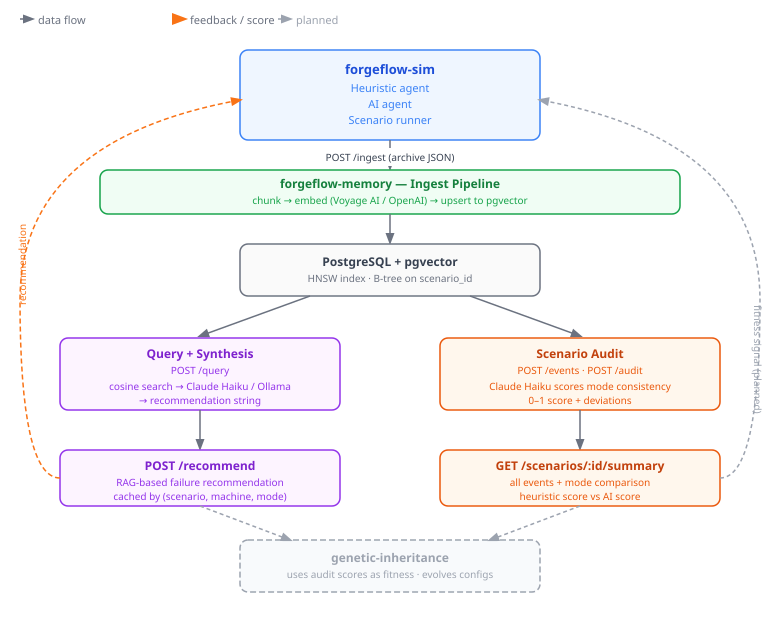

# ForgeFlow Architecture

> **Status:** Active development. The architecture below represents the desired goal. Core memory, audit, and recommendation layers are fully implemented. Integration between forgeflow-sim and forgeflow-memory, and the genetic-inheritance module, are planned next steps.

---

## Overview

ForgeFlow is a manufacturing simulation platform that compares two agent operating modes — **heuristic** (fixed rules) and **AI** (dynamic optimisation) — across failure and recovery scenarios. The system is designed to accumulate memory of past events, score agent behavior, and eventually feed those scores back into a genetic algorithm that evolves better simulation configurations over time.

The platform is split into three modules:

- **forgeflow-sim** — runs the simulation, generates events, hosts the two agent modes
- **forgeflow-memory** — persists events as vector embeddings, retrieves them by semantic similarity, synthesises recommendations, and scores agent consistency
- **genetic-inheritance** — uses audit scores as fitness signals to evolve scenario configurations (planned)

---

## Data Flow

The diagram below shows how the three modules connect. Solid lines are implemented today. Dashed lines are planned.

---

## Key Design Decisions

**Why pgvector over a dedicated vector DB?** Keeping vectors in Postgres avoids an extra infrastructure dependency and allows SQL filters (scenario, node, event type) to run before the HNSW similarity search rather than post-filtering a larger result set. See [ADR 001](docs/adr/001-pgvector-over-dedicated-vector-db.md).

**Why two LLM providers?** Anthropic (Claude Haiku) is the default for synthesis and audit — reliable structured JSON output, low latency, low cost. Ollama is supported as a free local alternative for synthesis when `SYNTHESIS_PROVIDER=ollama`. The audit endpoint always uses Anthropic because the scoring logic requires consistent JSON.

**Why a recommendation cache?** Recommendations are expensive (embed → search → synthesise). The same failure pattern in the same scenario with the same mode will always produce the same recommendation. The cache keys on `(scenarioId, machineId, failureType, mode)` and is invalidated automatically on new ingest.

**Why LLM-as-judge in the eval pipeline?** Cosine similarity measures retrieval recall but not faithfulness — a model can retrieve the right chunks and still hallucinate. The judge prompt independently scores whether the synthesis is grounded in the retrieved context. See [ADR 002](docs/adr/002-llm-as-judge-for-faithfulness.md).

---

## Modules at a Glance

| Module | Responsibility | Status |
|---|---|---|
| `forgeflow-sim` | Simulation engine, heuristic + AI agents | Active |
| `forgeflow-memory` | Event persistence, semantic retrieval, audit, recommendations | Active |
| `genetic-inheritance` | Fitness-based config evolution using audit scores | Planned |

---

## Next Steps

- Wire `POST /ingest` and `POST /recommend` calls from forgeflow-sim into the memory layer
- Surface `GET /scenarios/:id/summary` in the forgeflow-sim UI for post-run analysis
- Implement genetic-inheritance module consuming audit scores as fitness signals
